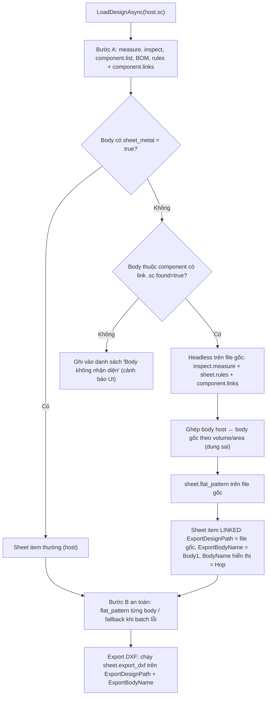

# Kế hoạch Fix: Add-in không nhận diện Sheet Metal trong file `.sc` được Insert/Link (Test2.sc)

> Ngày lập: 30/10/2026 — Phiên 003
> File test: `test\Test2.sc` (link tới `C:\Users\Admin\Documents\Hop.sc`)

---

## 1. Hiện tượng

Mở `test\Test2.sc` → Add-in chỉ liệt kê `P-1`, `P-2`, `P-3`. Body `Hop` (là chi tiết **sheet metal** trong `Hop.sc`, rule `PL4-SS400`, dày 4mm, 4 đường chấn) **bị bỏ qua**.

## 2. Phân tích nguyên nhân (đã kiểm chứng bằng `solidcraft-cli` v0.24.0)

### 2.1. Nguyên nhân gốc: Body được insert từ file `.sc` khác là "body câm" (dumb solid)
Khi dùng `component.insert_design` (Insert Design), SolidCraft tạo feature `type: "import"` và lưu hình học dưới dạng **STEP blob** (`blobs/<sha>.step`) trong file host. Toàn bộ lịch sử sheet metal (`sheet_base`, `sheet_flange`, rule) **không được mang theo**:

| Nguồn | Body | `sheet_metal` (inspect.measure) | `sheet.flat_pattern` |
|---|---|---|---|
| `Test2.sc` | `P-1`, `P-2`, `P-3` | `true` | OK |
| `Test2.sc` | `Hop` (feature `import`, component 16) | **không có field** | ❌ `` `Hop` is not a sheet metal body `` |
| `Hop.sc` (file gốc) | `Body1` | `true` | ✅ rule `PL4-SS400`, thick 4.0, flat 586.85×486.85, 4 bends |

→ Code tại [SolidCraftCliService.cs](../SolidCraftDxfAddIn/Services/SolidCraftCliService.cs) (bước 4, lọc `b["sheet_metal"] == true`) loại `Hop` là **đúng theo dữ liệu CLI trả về**; vấn đề là Add-in chưa biết cách "đi theo link" để lấy dữ liệu sheet metal từ file gốc.

### 2.2. Dữ liệu sẵn có để giải quyết (API chính thức của CLI)
- `component.links` trên file host trả về:
  ```json
  {"links":[{"component":16,"name":"Hop","file":"C:\\Users\\Admin\\Documents\\Hop.sc","path":"...","found":true}]}
  ```
- `component.list` → component 16 chứa body `Hop`.
- **Ánh xạ body host ↔ body gốc**: thể tích/diện tích khớp tuyệt đối:
  `Hop` (host) = `781282.0152567` mm³ / `399304.68557` mm² ↔ `Body1` (Hop.sc) = `781282.0152567` mm³ / `399304.68557` mm².
- `assembly.bom` của host → component 16 có `count` (số lượng occurrence) → dùng làm số lượng.

### 2.3. Lỗi phụ phát hiện thêm (nghiêm trọng)
`solidcraft-cli run` **dừng toàn bộ batch và KHÔNG ghi `--json-out`** khi có 1 step lỗi (exit code 1). Cờ `--allow-errors` chỉ áp dụng cho lỗi *feature trên timeline*, không áp dụng cho lỗi *step trong script*.
→ Hiện tại ở **Bước B** (batch `sheet.flat_pattern` cho mọi body), chỉ cần **1 body lỗi trải phẳng** là toàn bộ việc nạp thiết kế bị exception, mất hết các body khác. Cơ chế `HasFlatPatternError` hiện có **không bao giờ được kích hoạt** ở chế độ Headless.

---

## 3. Giải pháp tổng thể



---

## 4. Các bước thực hiện chi tiết

### Bước 1 — Sửa lỗi batch dừng toàn bộ (làm trước, độc lập)
**File:** `Services/SolidCraftCliService.cs`
- [ ] Trong `ExecuteBatchHeadlessAsync`: khi không có `tempResultPath` và exit code ≠ 0 → ném exception có kiểu riêng `SolidCraftBatchStepException` chứa `StepIndex` (parse từ stderr `error: step N (command): message`) và `Message`.
- [ ] Thêm hàm `ExecuteBatchTolerantAsync(...)`: chạy batch; nếu gặp `SolidCraftBatchStepException` tại step N → ghi `{"error": message}` cho step N, chạy tiếp phần còn lại (step N+1..cuối) theo vòng lặp. Trả về `JsonArray` đủ số phần tử, step lỗi có field `error`.
  - (Live mode: kiểm tra response `engine.batch` — nếu `ok=false` cũng áp dụng cùng chiến lược tách batch.)
- [ ] Bước B (`flat_pattern`) dùng `ExecuteBatchTolerantAsync` → `HasFlatPatternError` hoạt động đúng thiết kế.

### Bước 2 — Mở rộng Model
**File:** `Models/SolidCraftModels.cs` — thêm vào `SolidCraftSheetItem`:
- [ ] `bool IsLinked` — body đến từ component link.
- [ ] `string ExportDesignPath` — file `.sc` dùng để chạy `flat_pattern`/`export_dxf`/`snapshot` (host hoặc file gốc).
- [ ] `string ExportBodyName` — tên body trong `ExportDesignPath` (VD `Body1`). `BodyName` giữ tên body trong host (`Hop`) để làm key `_sheetItemsMap` và hiển thị → tránh trùng tên giữa các file.
- [ ] `string LinkedSourceName` — tên file gốc (hiển thị tooltip/cột ghi chú).
- [ ] `bool IsLinkStale` — component trong host khác với file gốc (cần Update Model).

Thêm vào `SolidCraftLoadResult`:
- [ ] `List<string> UnrecognizedBodies` — body không phải sheet metal & không truy được nguồn (để cảnh báo).
- [ ] `List<string> Warnings` — VD: link `found=false`, file gốc không mở được, không ghép được body.

### Bước 3 — Nhận diện body từ component link
**File:** `Services/SolidCraftCliService.cs` (`LoadDesignAsync`)
- [ ] Thêm `component.links` vào Bước A (lệnh thứ 6). Bọc an toàn: nếu phiên bản CLI không hỗ trợ → coi như không có link.
- [ ] Xây `compIdToLink: Dictionary<ulong, (string file, bool found)>` (chỉ nhận `file` đuôi `.sc`).
- [ ] Từ `inspect.measure`, các body **không** `sheet_metal` mà `bodyToCompMap[body].compId` ∈ `compIdToLink` → nhóm theo file gốc.
- [ ] Viết hàm mới `ResolveLinkedSheetBodiesAsync(cliPath, sourceFile, hostBodies, depth, visited)`:
  1. Headless trên `sourceFile`: `inspect.measure`, `sheet.rules`, `component.links`, `component.list`.
  2. Lấy các body `sheet_metal=true` của file gốc.
  3. **Ghép** từng body host với body gốc: so `volume_mm3` (sai số tương đối ≤ 1e-6) **và** `area_mm2` (≤ 1e-6). Nếu file gốc chỉ có đúng 1 body và host component chỉ có 1 body → ghép trực tiếp (vẫn log cảnh báo nếu volume lệch).
  4. Body gốc nào **không phải sheet metal** nhưng lại thuộc link cấp tiếp theo → **đệ quy** (giới hạn `depth ≤ 5`, `visited` HashSet chống vòng lặp link).
  5. Chạy `sheet.flat_pattern` (tolerant) trên file gốc cho các body ghép được.
- [ ] Tạo `SolidCraftSheetItem` với `IsLinked=true`, `BodyName = "Hop"` (host), `ExportBodyName = "Body1"`, `ExportDesignPath = <Hop.sc>`, rule/thickness lấy từ `sheet.rules` **của file gốc** (`PL4-SS400` = 4mm — host không có rule này).
- [ ] Vật liệu: ưu tiên `material` của body trong file gốc; nếu là `Default` thì dùng material của body host; nếu vẫn `Default` → giữ nguyên `Default` (**KHÔNG** suy vật liệu từ tên rule — đã chốt với người dùng).
- [ ] Số lượng & PartNumber: lấy từ BOM host theo component id (như hiện tại) — vì `Hop:1` là occurrence trong host.
- [ ] Refactor phần "phân tích flat_pattern → SheetItem" (dòng 544–624 hiện tại) thành hàm `ApplyFlatPatternResult(item, fRes, rulesDict)` để dùng chung cho body thường và body linked.
- [ ] Body link `found=false` hoặc ghép thất bại → thêm vào `UnrecognizedBodies` + `Warnings` (không throw).

### Bước 3b — Phát hiện link lỗi thời & tự cập nhật link khi Update Model
> Đã chốt: **Add-in cảnh báo** khi link lỗi thời; khi người dùng bấm **Update Model** (`ReloadCurrentModelAsync`) thì **cập nhật luôn các link được chèn**.

Đã kiểm chứng: `component.update_links` chạy được headless, trả về `{"updated":[...], "unchanged":[...], "warnings":[...]}`; kết hợp `--save` sẽ ghi lại file host.

**a) Phát hiện lỗi thời khi nạp (không sửa file):**
- [ ] Headless: thêm `component.update_links` vào batch Bước A **không kèm `--save`** (chỉ thay đổi trong phiên CLI, file không đổi). Component nằm trong `updated` ⇒ link lỗi thời → thêm Warning *"Component 'Hop' khác với file gốc Hop.sc – bấm Update Model để cập nhật"* và đánh dấu `item.IsLinkStale = true`.
  - Lưu ý thứ tự: `component.update_links` phải chạy **sau** `inspect.measure`/`component.list` để số liệu body host phản ánh trạng thái thật của file.
- [ ] Live: KHÔNG gửi `update_links` khi chỉ nạp (sẽ làm bẩn tài liệu trong GUI). Dùng `engine.batch` với `rollback: true` để chạy thử; nếu CLI/GUI không hỗ trợ rollback cho lệnh này → fallback so sánh volume/area body host ↔ body gốc (lệch > 1e-6 ⇒ lỗi thời).
- [ ] Bất kể lỗi thời hay không, dữ liệu sheet metal/DXF luôn lấy theo **file gốc** (nguồn sự thật).

**b) Cập nhật link khi bấm Update Model:**
- [ ] Thêm `SolidCraftCliService.UpdateLinksAsync(designPath, useLiveApp)`:
  - Live: gửi `component.update_links` qua TCP (`rollback: false`) → tài liệu trong GUI được cập nhật (một bước Undo); người dùng tự Save trong SolidCraft.
  - Headless: tạo bản sao lưu `<file>.sc.bak` (ghi đè bản cũ) rồi chạy `solidcraft-cli run <script> --in <file> --save <file>`; chỉ ghi file khi `updated` không rỗng (chạy dry-check trước, tránh ghi file không cần thiết). File đang bị khoá/ghi thất bại → Warning, không crash.
- [ ] `MainViewModel.ReloadCurrentModelAsync`: gọi `UpdateLinksAsync` **trước** khi `LoadDesignFromFileAsync` / `ConnectLiveAsync`; hiển thị kết quả (`updated`, `warnings` – VD joint mất mặt liên kết).
- [ ] Đệ quy: khi file gốc cũng có link lỗi thời, chỉ **cảnh báo** (không tự sửa file gốc của người khác).

### Bước 4 — Xuất DXF & Thumbnail theo nguồn thực
- [ ] `ExportSheetBodyDxfAsync`: thêm overload nhận `SolidCraftSheetItem`. Nếu `IsLinked` → **luôn** chạy Headless trên `ExportDesignPath` với `ExportBodyName` (kể cả khi đang ở chế độ Live, vì GUI không có sheet data của body link).
- [ ] `SolidCraftDxfExportManager.cs` dòng ~93: truyền `sheetItem` khi có; giữ đường cũ khi `sheetItem == null`.
- [ ] `CaptureThumbnailAsync`: dùng `item.ExportDesignPath` + `item.ExportBodyName`.
- [ ] Ở chế độ Live: `LoadDesignAsync` cũng chạy `component.links` qua TCP; phần đọc file gốc vẫn dùng Headless CLI (yêu cầu có `solidcraft-cli.exe`; nếu không có → Warning).

### Bước 5 — UI / thông báo
**File:** `ViewModels/MainViewModel.cs`, `Views/MainWindow.xaml`, `Services/LocalizationService.cs`
- [ ] Sau khi nạp: nếu `Warnings`/`UnrecognizedBodies` không rỗng → hiển thị thông báo tổng hợp (Growl/MessageBox HandyControl), VD: *"Body 'X' được import từ STEP, không phải sheet metal – bỏ qua"*.
- [ ] Đánh dấu dòng linked (icon 🔗 hoặc tooltip "Từ file: Hop.sc / Body1").
- [ ] Bổ sung chuỗi VI/EN tương ứng.

### Bước 6 — Kiểm thử
- [ ] `dotnet build -c Debug` / `-c Release`: 0 warning, 0 error.
- [ ] Test2.sc (Headless): danh sách hiển thị **4 dòng** `P-1`, `P-2`, `P-3`, `Hop`; `Hop` có thick 4.0, rule `PL4-SS400`, 4 bends, flat ≈ 586.85×486.85, Qty 1.
- [ ] Xuất DXF `Hop` → file DXF hợp lệ (layer `OUTLINE`, `BEND_*` → chuẩn hoá `IV_*`), gộp đúng nhóm `PL4-...`.
- [ ] Test.sc (đã có): `Hop` cũng xuất hiện (link `../Documents/Hop.sc` – đường dẫn tương đối, kiểm tra `file` resolved); `Body1` (extrude thường) và `Hex Nut` không bị liệt kê.
- [ ] Đổi tên/di chuyển `Hop.sc` tạm thời → không crash, có Warning "link không tìm thấy".
- [ ] Link lỗi thời (làm trên **bản sao** của Test2.sc + Hop.sc): sửa chiều cao flange trong bản sao Hop.sc → nạp lại thấy Warning lỗi thời, file host **không** bị đổi; bấm Update Model → có `.sc.bak`, `component.update_links` báo `updated: ["Hop"]`, nạp lại hết Warning.
- [ ] Tạo 1 body cố ý lỗi trải phẳng → các body khác vẫn nạp, body lỗi hiện `HasFlatPatternError`.
- [ ] Chế độ Live (nếu mở GUI): Test2 mở trong SolidCraft → `Hop` vẫn được nhận và xuất DXF qua Headless.

### Bước 7 — Cập nhật Memory
- [ ] `issues.md`: thêm mục 6 "Body insert từ .sc là STEP blob, mất dữ liệu sheet metal" và mục 7 "CLI dừng cả batch khi 1 step lỗi".
- [ ] `architecture.md`: mô tả hàm mới.
- [ ] `Tracking.md`: ghi phiên làm việc.

---

## 5. Hướng mở rộng (HOÃN – người dùng chốt "để sau")
**Body import thuần từ STEP (không có file `.sc` gốc)**: có thể thử `sheet.convert` ngay trong phiên headless (không lưu file host): dùng `model.faces` tìm mặt phẳng lớn nhất làm `face`, các mặt trụ (bend có bán kính) làm `bends`, rồi gọi `sheet.flat_pattern`/`sheet.export_dxf` trong **cùng một batch**. Độ tin cậy phụ thuộc hình học → nên là tính năng tuỳ chọn "Thử chuyển đổi sang Sheet Metal".

## 6. Quyết định đã chốt với người dùng (30/10/2026)
| # | Vấn đề | Quyết định |
|---|---|---|
| 1 | File gốc đã bị sửa sau khi insert (link lỗi thời) | **Add-in cảnh báo**; khi người dùng bấm **Update Model** thì chạy `component.update_links` để cập nhật luôn link được chèn (xem Bước 3b) |
| 2 | Vật liệu body linked là `Default` | **Không** suy vật liệu từ tên rule – giữ nguyên |
| 3 | Body import thuần từ STEP (`sheet.convert`) | **Để sau** (mục 5) |
| 4 | Mỗi file gốc tốn thêm 1–2 lần gọi CLI (~1s/lần) | Cache kết quả theo `(path, LastWriteTime)` trong phiên (tự quyết, không ảnh hưởng hành vi) |

