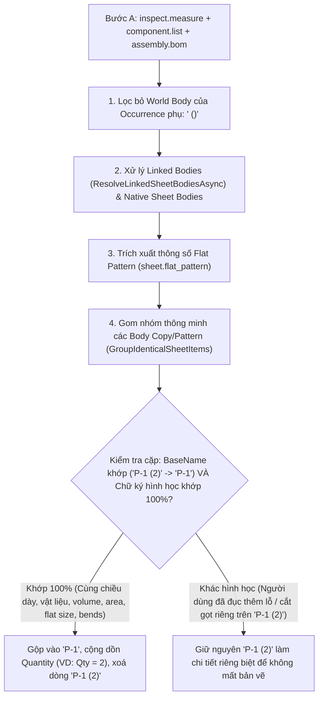

# KẾ HOẠCH NÂNG CẤP: TỰ ĐỘNG GOM NHÓM & CỘNG DỒN SỐ LƯỢNG CÁC BODY COPY / PATTERN (`P-1 (2)` → `P-1`) & XỬ LÝ OCCURRENCE TRONG SOLIDCRAFT

> **Dành cho AI thực thi (Gemini Flash 3.8):**  
> Tài liệu này hướng dẫn chi tiết từng bước từ A → Z để nâng cấp `SolidCraftCliService.cs`, `MainViewModel.cs` và bộ kiểm thử `TestRunner.cs` nhằm giải quyết triệt để vấn đề nhân bản chi tiết bằng lệnh **Copy (`Move/Copy`)**, **Pattern (`Rectangular/Circular/Path Pattern`)**, **Mirror / Paste Bodies** và **Component Occurrences** trong phần mềm **SolidCraft**.  
> **Quy tắc bắt buộc:** Đọc `Memory/memory.md` trước khi làm và ghi nhật ký đầy đủ vào `Memory/Tracking.md` sau khi hoàn thành.

---

## 1. HIỆN TƯỢNG & NGUYÊN NHÂN GỐC RỄ (ĐÃ KIỂM CHỨNG TRÊN `test\Test2.sc` & `test\up_down.sc`)

### 1.1. Hiện tượng thực tế trên `test\Test2.sc`
Khi người dùng mở file `test\Test2.sc` (hoặc làm việc trực tiếp trên SolidCraft):
1. **Nhân bản Body gốc bằng lệnh Move/Copy (`solid.move` với `copy: true`):**
   - Chi tiết `P-3` được copy thêm 1 bản trong không gian 3D $\rightarrow$ SolidCraft tạo ra body mới tên là **`P-3 (2)`**.
   - Add-in hiện tại liệt kê thành **2 dòng riêng biệt**: `P-3` (Số lượng = 1) và `P-3 (2)` (Số lượng = 1), xuất ra 2 file DXF rời thay vì **1 dòng `P-3` với Số lượng = 2**.
2. **Nhân bản Body của Component liên kết (`up_down.sc`) bằng lệnh Pattern (`solid.pattern.rectangular` với `bodies`):**
   - Component `up_down` (link tới `test\up_down.sc`) có 2 body gốc là `Px-1` và `Px-2`.
   - Khi người dùng dùng lệnh `RectangularPattern1` (`count = 3`) trên 2 body này trong `Test2.sc`, SolidCraft tạo ra 6 body trong component `up_down`:
     - `Px-1`, `Px-1 (2)`, `Px-1 (3)`
     - `Px-2`, `Px-2 (2)`, `Px-2 (3)`
   - Add-in hiện tại liệt kê thành **6 dòng rời rạc** (mỗi dòng Số lượng = 1) thay vì gộp thành **2 dòng**: `Px-1` (Số lượng = 3) và `Px-2` (Số lượng = 3).
3. **Nhân bản ở cấp độ Component / Occurrence (`occurrence.copy` hoặc `solid.pattern.*` với `components`):**
   - Khi một Component (ví dụ `P-3`) được nhân bản thành 3 Occurrences (`P-3:1`, `P-3:2`, `P-3:3`), `assembly.bom` đã trả về `count = 3`.
   - Tuy nhiên, lệnh `inspect.measure` trả về toàn bộ các khối trong World Space bao gồm cả các bản thể thứ 2, thứ 3 với tên dạng `<BodyName> (<OccName>)`, ví dụ: **`P-3 (P-3:2)`**, **`P-3 (P-3:3)`**, **`P-2 (P-3:2)`**, **`P-2 (P-3:3)`**.
   - Vì `component.list` chỉ liệt kê tên body gốc `"P-3"` và `"P-2"`, các tên có hậu tố `(P-3:2)` không khớp `bodyToCompMap` $\rightarrow$ bị coi là body độc lập và đẻ thêm dòng thừa trên bảng UI!

---

## 2. KIẾN TRÚC GIẢI PHÁP KỸ THUẬT



### 2.1. Ba quy tắc vàng đảm bảo chính xác 100% trong sản xuất CNC

1. **Quy tắc 1 — Lọc bỏ World Bodies của Occurrence phụ (`IsSecondaryOccurrenceWorldBody`):**
   - Từ kết quả `component.list`, thu thập tập hợp tất cả tên Occurrence (`occName`, ví dụ `"P-3:1"`, `"P-3:2"`, `"P-3:3"`, `"Hop:1"`...) của mọi Component.
   - Khi duyệt mảng `bodies` của `inspect.measure`: nếu tên body có định dạng `<BaseBodyName> (<OccName>)` mà `<OccName>` nằm trong danh sách tên Occurrence (và `<BaseBodyName>` là body của Component đó) $\rightarrow$ **Bỏ qua ngay lập tức** không đưa vào `nativeSheetBodies`, `candidateLinkedBodies` hay `UnrecognizedBodies`, bởi vì số lượng của Occurrence đó đã được tính trong `assembly.bom` (`count`)!

2. **Quy tắc 2 — Tính đúng số lượng Occurrence cho cả Component không có trong `assembly.bom`:**
   - Trong `component.list`, mỗi Component có mảng `"occurrences"`. Nếu một Component có `occurrences.Count > 1` nhưng vì lý do nào đó không xuất hiện trong `compToBomMap`, số lượng Occurrence của Component đó là `Math.Max(1, occurrences.Count)`.

3. **Quy tắc 3 — Gom nhóm các Body sinh ra từ lệnh Copy / Pattern (`GroupIdenticalCopiedSheetItems`):**
   - **Hàm tách tên gốc (`GetCopyPatternBaseName(string name)`):**
     - Nhận diện mẫu tên sinh tự động của SolidCraft khi Copy / Pattern body:
       `^(.+?)\s*\(\d+\)$` (ví dụ: `"P-1 (2)"` $\rightarrow$ `"P-1"`, `"Px-1 (3)"` $\rightarrow$ `"Px-1"`, `"P-3 (2)"` $\rightarrow$ `"P-3"`).
     - Nếu không có hậu tố `(số)`, trả về chính tên đó.
   - **Điều kiện để gộp một `item` (`P-1 (2)`) vào `targetItem` (`P-1`):**
     Hai `SolidCraftSheetItem` được phép gộp và cộng dồn `Quantity` khi và chỉ khi thoả mãn **đồng thời** tất cả các điều kiện sau:
     1. Cùng tên gốc sau khi bỏ hậu tố `(\d+)`: `GetCopyPatternBaseName(item.BodyName)` trùng với `GetCopyPatternBaseName(target.BodyName)` (không phân biệt hoa thường).
     2. Cả hai đều không bị lỗi trải phẳng (`!item.HasFlatPatternError && !target.HasFlatPatternError`).
     3. Cùng trạng thái nguồn liên kết:
        - Nếu là `IsLinked == true`: phải cùng `ExportDesignPath` và cùng `ExportBodyName` (ví dụ `Px-1`, `Px-1 (2)`, `Px-1 (3)` đều trỏ về `ExportBodyName = "Px-1"` trong `up_down.sc`).
     4. **Cùng Chữ ký Hình học & Trải phẳng (Geometric & Flat Pattern Signature):**
        - Cùng vật liệu: `string.Equals(item.MaterialName, target.MaterialName, StringComparison.OrdinalIgnoreCase)`.
        - Cùng chiều dày thực tế: `Math.Abs(item.ActualThicknessMm - target.ActualThicknessMm) <= 0.01`.
        - Cùng số lượng đường chấn: `item.BendCount == target.BendCount` (và `item.BendUpCount == target.BendUpCount`, `item.BendDownCount == target.BendDownCount`).
        - Cùng kích thước bao trải phẳng 2D (cho phép hoán vị rộng/dài do xoay trục khi Copy/Move):
          $$\min(W_1, H_1) \approx \min(W_2, H_2) \quad \text{và} \quad \max(W_1, H_1) \approx \max(W_2, H_2) \quad (\text{sai số } \le 0.05\text{ mm})$$
        - Cùng thể tích 3D (`VolumeMm3`) và diện tích bề mặt (`AreaMm2`) (sai số tương đối $\le 10^{-3}$ tức $0.1\%$):
          $$\frac{|V_1 - V_2|}{\max(1.0, V_1)} \le 10^{-3}, \quad \frac{|A_1 - A_2|}{\max(1.0, A_1)} \le 10^{-3}$$
   - **Khi gộp nhóm thành công:**
     - Chọn phần tử có tên gốc chuẩn (không có hậu tố `(2)`, ví dụ `"P-1"`, `"P-3"`, `"Px-1"`) làm phần tử đại diện chính (`primaryItem`).
     - Đặt `primaryItem.PartNumber` về tên gốc chuẩn nếu `PartNumber` đang mang tên có hậu tố `(2)`.
     - Cộng dồn số lượng:
       `primaryItem.Quantity = group.Sum(x => Math.Max(1, x.Quantity))`
     - Lưu ý đặc biệt với Linked Component:
       Trong `ResolveLinkedSheetBodiesAsync`, nếu Component `up_down` có `bomInfo.qty = 1` (1 occurrence của `up_down`), nhưng bên trong `up_down` có 3 body `Px-1`, `Px-1 (2)`, `Px-1 (3)`, mỗi body ban đầu mang `Quantity = bomInfo.qty` (tức `1`). Khi gộp 3 body này lại, tổng `Quantity` của `Px-1` sẽ tự động bằng $1 + 1 + 1 = 3$ (và nếu `up_down` có 2 occurrences tức `bomInfo.qty = 2`, tổng `Quantity` sẽ là $2 + 2 + 2 = 6$ — hoàn toàn chính xác!).

---

## 3. HƯỚNG DẪN THỰC HIỆN CHI TIẾT TỪNG BƯỚC

---

### BƯỚC 1: Bổ sung `VolumeMm3` và `AreaMm2` vào `SolidCraftSheetItem` (`Models/SolidCraftModels.cs`)

Mở file `d:\05_MyCode\SolidCraftDxfAddIn\SolidCraftDxfAddIn\Models\SolidCraftModels.cs` và thêm 2 thuộc tính lưu thể tích & diện tích 3D vào class `SolidCraftSheetItem` để phục vụ đối chứng hình học:

```csharp
        public double VolumeMm3 { get; set; }
        public double AreaMm2 { get; set; }
```

---

### BƯỚC 2: Nâng cấp `SolidCraftCliService.cs`

Mở file `d:\05_MyCode\SolidCraftDxfAddIn\SolidCraftDxfAddIn\Services\SolidCraftCliService.cs` và thực hiện 4 cập nhật sau:

#### 2.1. Thu thập danh sách Occurrence và lọc bỏ World Body của Occurrence phụ (`<Body> (<OccName>)`)
Tại mục **2. Phân tích component list** trong `LoadDesignAsync` (khoảng dòng 736):
- Thu thập thêm `occurrenceNames` (tất cả `occ["name"]` trong mảng `c["occurrences"]` và `c["children"]`) và `compOccurrenceCount` (`ulong compId -> int occCount`):
```csharp
            var bodyToCompMap = new Dictionary<string, (ulong compId, string compName)>(StringComparer.OrdinalIgnoreCase);
            var secondaryOccurrenceNames = new HashSet<string>(StringComparer.OrdinalIgnoreCase);
            var compOccurrenceCount = new Dictionary<ulong, int>();

            if (compListRes?["components"] is JsonArray compArr)
            {
                foreach (var c in compArr)
                {
                    var cId = c?["id"]?.GetValue<ulong>() ?? 0;
                    var cName = c?["name"]?.ToString() ?? string.Empty;
                    var occArr = c?["occurrences"] as JsonArray;
                    int occCount = occArr?.Count ?? 0;
                    if (cId > 0)
                    {
                        compOccurrenceCount[cId] = Math.Max(1, occCount);
                    }

                    if (occArr != null)
                    {
                        // Occurrence đầu tiên (index 0) dùng tên body gốc; từ index 1 trở đi inspect.measure gắn hậu tố " (<occName>)"
                        for (int occIdx = 1; occIdx < occArr.Count; occIdx++)
                        {
                            var occName = occArr[occIdx]?["name"]?.ToString();
                            if (!string.IsNullOrWhiteSpace(occName))
                            {
                                secondaryOccurrenceNames.Add(occName);
                            }
                        }
                    }

                    if (c?["bodies"] is JsonArray cBodies)
                    {
                        foreach (var b in cBodies)
                        {
                            var bName = b?.ToString();
                            if (!string.IsNullOrWhiteSpace(bName))
                            {
                                bodyToCompMap[bName] = (cId, cName);
                            }
                        }
                    }
                }
            }
```

- Ngay đầu vòng lặp `foreach (var b in bodiesArr)` tại mục **5. Phân loại bodies từ inspect.measure** (khoảng dòng 804):
  Kiểm tra xem `bName` có phải là World Body sinh ra từ Occurrence thứ 2 trở đi hay không (ví dụ `"P-3 (P-3:2)"`):
```csharp
                    var bName = b?["name"]?.ToString() ?? string.Empty;
                    if (string.IsNullOrWhiteSpace(bName)) continue;

                    // Bỏ qua các World Body của Occurrence phụ (VD: "P-3 (P-3:2)") vì số lượng đã được tính trong BOM / Occurrences
                    if (IsSecondaryOccurrenceWorldBody(bName, secondaryOccurrenceNames, bodyToCompMap))
                    {
                        continue;
                    }
```
  Với hàm helper:
```csharp
        private static bool IsSecondaryOccurrenceWorldBody(
            string bodyName,
            HashSet<string> secondaryOccurrenceNames,
            Dictionary<string, (ulong compId, string compName)> bodyToCompMap)
        {
            if (secondaryOccurrenceNames.Count == 0) return false;
            if (bodyToCompMap.ContainsKey(bodyName)) return false;

            int openParen = bodyName.LastIndexOf(" (", StringComparison.Ordinal);
            if (openParen <= 0 || !bodyName.EndsWith(")", StringComparison.Ordinal)) return false;

            string baseBody = bodyName.Substring(0, openParen).Trim();
            string suffix = bodyName.Substring(openParen + 2, bodyName.Length - openParen - 3).Trim();

            return secondaryOccurrenceNames.Contains(suffix) && bodyToCompMap.ContainsKey(baseBody);
        }
```

#### 2.2. Gán `VolumeMm3` và `AreaMm2` khi tạo `SolidCraftSheetItem`
- Trong `LoadDesignAsync` (khi tạo `sheetItem` cho `nativeSheetBodies`, khoảng dòng 963):
  Gán thêm:
  ```csharp
  VolumeMm3 = sb.volume,
  AreaMm2 = sb.area,
  ```
- Trong `ResolveLinkedSheetBodiesAsync` (khi tạo `sheetItem` cho linked bodies, khoảng dòng 1223):
  Gán thêm:
  ```csharp
  VolumeMm3 = sb.Volume,
  AreaMm2 = sb.Area,
  ```
  Và chú ý ở phần gán `PartNumber` của linked body (dòng 1243):
  Nếu `bomInfo.partNum` rỗng, khi file gốc chỉ có 1 body (như `Hop.sc` có `Body1`), giữ `hb.Name` (`"Hop"`), nhưng nếu `hb.Name` là bản copy/pattern (như `"Px-1 (2)"` khớp với `sb.Name = "Px-1"`), hoặc luôn dùng `GetCopyPatternBaseName(hb.Name)` làm `PartNumber` mặc định khi `bomInfo.partNum` rỗng.

#### 2.3. Viết hàm `GroupIdenticalCopiedSheetItems` và gọi trước Bước C (Chụp Thumbnail)
Trong `LoadDesignAsync`, ngay sau khi đã thu thập xong toàn bộ `result.SheetItems` (cả Linked và Native, khoảng dòng 1010) và **trước khi chạy Bước C (CaptureThumbnailAsync)** — nhờ gộp trước Bước C nên sẽ **không phải chụp lại ảnh thumbnail trùng lặp** cho `P-1 (2)`, `Px-1 (2)`, `Px-1 (3)` (giúp tốc độ nạp file nhanh gấp 2–3 lần!):

```csharp
            // Gộp các body được nhân bản bằng lệnh Copy / Pattern (VD: P-1 (2) -> P-1, Px-1 (2),(3) -> Px-1)
            result.SheetItems = GroupIdenticalCopiedSheetItems(result.SheetItems);
```

Cài đặt chi tiết `GetCopyPatternBaseName` và `GroupIdenticalCopiedSheetItems`:
```csharp
        private static readonly Regex CopySuffixRegex = new(@"^(.+?)\s*\(\d+\)$", RegexOptions.Compiled);

        /// <summary>
        /// Tách tên gốc của Body nếu tên có hậu tố nhân bản tự động của SolidCraft: "P-1 (2)" -> "P-1".
        /// </summary>
        public static string GetCopyPatternBaseName(string name)
        {
            if (string.IsNullOrWhiteSpace(name)) return string.Empty;
            var m = CopySuffixRegex.Match(name.Trim());
            return m.Success ? m.Groups[1].Value.Trim() : name.Trim();
        }

        private static bool AreSheetItemsGeometricallyIdentical(SolidCraftSheetItem a, SolidCraftSheetItem b)
        {
            if (a.HasFlatPatternError || b.HasFlatPatternError) return false;
            if (a.IsLinked != b.IsLinked) return false;

            if (a.IsLinked)
            {
                if (!string.Equals(a.ExportDesignPath, b.ExportDesignPath, StringComparison.OrdinalIgnoreCase))
                    return false;
                if (!string.Equals(a.ExportBodyName, b.ExportBodyName, StringComparison.OrdinalIgnoreCase))
                    return false;
            }

            if (!string.Equals(a.MaterialName, b.MaterialName, StringComparison.OrdinalIgnoreCase))
                return false;

            if (Math.Abs(a.ActualThicknessMm - b.ActualThicknessMm) > 0.01)
                return false;

            if (a.BendCount != b.BendCount ||
                a.BendUpCount != b.BendUpCount ||
                a.BendDownCount != b.BendDownCount)
                return false;

            // So sánh kích thước phôi trải phẳng 2D (không phụ thuộc góc xoay 90 độ trên mặt phẳng)
            double aMin = Math.Min(a.FlatWidthMm, a.FlatHeightMm);
            double aMax = Math.Max(a.FlatWidthMm, a.FlatHeightMm);
            double bMin = Math.Min(b.FlatWidthMm, b.FlatHeightMm);
            double bMax = Math.Max(b.FlatWidthMm, b.FlatHeightMm);
            if (Math.Abs(aMin - bMin) > 0.05 || Math.Abs(aMax - bMax) > 0.05)
                return false;

            // So sánh thể tích 3D và diện tích bề mặt (dung sai 0.1%)
            if (a.VolumeMm3 > 0 && b.VolumeMm3 > 0)
            {
                double relVol = Math.Abs(a.VolumeMm3 - b.VolumeMm3) / Math.Max(1.0, a.VolumeMm3);
                if (relVol > 1e-3) return false;
            }

            if (a.AreaMm2 > 0 && b.AreaMm2 > 0)
            {
                double relArea = Math.Abs(a.AreaMm2 - b.AreaMm2) / Math.Max(1.0, a.AreaMm2);
                if (relArea > 1e-3) return false;
            }

            return true;
        }

        private static List<SolidCraftSheetItem> GroupIdenticalCopiedSheetItems(List<SolidCraftSheetItem> items)
        {
            if (items.Count <= 1) return items;

            var groupedResult = new List<SolidCraftSheetItem>();
            var visited = new bool[items.Count];

            // Sắp xếp ưu tiên phần tử có tên gốc (không có hậu tố "(2)") đứng trước để làm đại diện chính
            var orderedIndices = new List<int>();
            for (int i = 0; i < items.Count; i++) orderedIndices.Add(i);
            orderedIndices.Sort((i, j) =>
            {
                bool iHasSuffix = CopySuffixRegex.IsMatch(items[i].BodyName);
                bool jHasSuffix = CopySuffixRegex.IsMatch(items[j].BodyName);
                if (iHasSuffix != jHasSuffix) return iHasSuffix ? 1 : -1;
                return i.CompareTo(j);
            });

            foreach (int idx in orderedIndices)
            {
                if (visited[idx]) continue;
                visited[idx] = true;

                var primary = items[idx];
                string primaryBaseName = GetCopyPatternBaseName(primary.BodyName);
                int totalQty = Math.Max(1, primary.Quantity);

                foreach (int otherIdx in orderedIndices)
                {
                    if (visited[otherIdx]) continue;
                    var candidate = items[otherIdx];
                    string candidateBaseName = GetCopyPatternBaseName(candidate.BodyName);

                    if (string.Equals(primaryBaseName, candidateBaseName, StringComparison.OrdinalIgnoreCase) &&
                        AreSheetItemsGeometricallyIdentical(primary, candidate))
                    {
                        visited[otherIdx] = true;
                        totalQty += Math.Max(1, candidate.Quantity);
                    }
                }

                primary.Quantity = totalQty;

                // Nếu đại diện được chọn vẫn mang tên có hậu tố "(2)" (VD bản gốc "P-1" đã bị xoá, chỉ còn "P-1 (2)" và "P-1 (3)")
                // hoặc PartNumber đang trùng với BodyName có hậu tố thì chuẩn hoá PartNumber về BaseName
                if (string.Equals(primary.PartNumber, primary.BodyName, StringComparison.OrdinalIgnoreCase))
                {
                    primary.PartNumber = primaryBaseName;
                }

                groupedResult.Add(primary);
            }

            return groupedResult;
        }
```

---

### BƯỚC 3: Kiểm thử nghiệm thu tự động trong `TestRunner.cs`

Mở file `d:\05_MyCode\SolidCraftDxfAddIn\SolidCraftDxfAddIn\TestRunner.cs` và bổ sung **TEST 9** kiểm tra trực tiếp việc gom nhóm các chi tiết Copy / Pattern trên `test\Test2.sc`:

1. Kiểm tra kết quả `LoadDesignAsync` trên `test\Test2.sc`:
   - Không còn các dòng trùng lặp `P-3 (2)`, `Px-1 (2)`, `Px-1 (3)`, `Px-2 (2)`, `Px-2 (3)` trong `loadResult.SheetItems`.
   - Chi tiết **`P-3`** có `Quantity == 2` (do gộp `P-3` và `P-3 (2)` từ lệnh Move/Copy).
   - Chi tiết **`Px-1`** có `Quantity == 3` (do gộp `Px-1`, `Px-1 (2)`, `Px-1 (3)` từ lệnh RectangularPattern).
   - Chi tiết **`Px-2`** có `Quantity == 3` (do gộp `Px-2`, `Px-2 (2)`, `Px-2 (3)` từ lệnh RectangularPattern).
   - Chi tiết **`P-1`**, **`P-2`**, **`Hop`**, **`spline`** đều có `Quantity == 1`.
2. Kiểm tra trường hợp **An toàn hình học (Safety Check)**:
   - Giả lập 2 `SolidCraftSheetItem` tên `"P-1"` và `"P-1 (2)"` nhưng `"P-1 (2)"` có `VolumeMm3` hoặc `FlatWidthMm` khác `"P-1"` (mô phỏng trường hợp người dùng Copy ra `P-1 (2)` rồi đục thêm lỗ / cắt ngắn đi):
   - Xác nhận thuật toán **KHÔNG gộp nhầm** mà giữ nguyên cả 2 dòng `"P-1"` (`Quantity = 1`) và `"P-1 (2)"` (`Quantity = 1`).
3. Chạy lệnh kiểm thử tự động:
   ```powershell
   dotnet build d:\05_MyCode\SolidCraftDxfAddIn\SolidCraftDxfAddIn.sln -c Debug
   dotnet build d:\05_MyCode\SolidCraftDxfAddIn\SolidCraftDxfAddIn.sln -c Release
   d:\05_MyCode\SolidCraftDxfAddIn\SolidCraftDxfAddIn\bin\Debug\net8.0-windows\SolidCraftDxfAddIn.exe --test
   ```
   - Đảm bảo toàn bộ **9/9 bài test đều PASSED (`0 Warning(s), 0 Error(s)`)**.

---

### BƯỚC 4: Cập nhật hệ thống tài liệu Memory

Sau khi hoàn thành code và vượt qua toàn bộ 9 bài test:
1. Cập nhật `Memory/issues.md`: bổ sung mục 9 giải thích cơ chế nhân bản Body vs Component của SolidCraft và thuật toán `GroupIdenticalCopiedSheetItems`.
2. Cập nhật `Memory/architecture.md`: mô tả các hàm mới trong `SolidCraftCliService.cs`.
3. Cập nhật `Memory/Tracking.md`: ghi chép đầy đủ kết quả thực hiện theo chuẩn Phiên làm việc.

