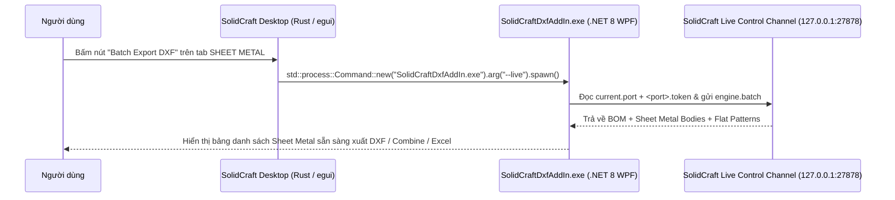

# KẾ HOẠCH TRIỂN KHAI (PHƯƠNG ÁN 3): TÍCH HỢP NÚT "BATCH EXPORT DXF" CHÍNH CHỦ VÀO MÃ NGUỒN RUST CỦA SOLIDCRAFT (`SHEET METAL` RIBBON TAB)

> **Dành cho AI thực thi (Gemini 3.8 Flash):**  
> Tài liệu này hướng dẫn chi tiết từng bước từ A → Z để thêm một nút bấm chính chủ (**`Batch Export DXF`**) vào tab **`SHEET METAL`** trên thanh Ribbon của phần mềm mã nguồn mở **SolidCraft** (`https://github.com/tangency-labs/solidcraft.git`), đồng thời nâng cấp `SolidCraftDxfAddIn.exe` nhận cờ `--live` để khi người dùng bấm nút trên Ribbon của SolidCraft, cửa sổ Add-in bật lên và tự động đọc ngay bản vẽ đang mở qua cổng TCP `27878`.  
> **Quy tắc bắt buộc:** Đọc `Memory/memory.md` trước khi làm và ghi nhật ký vào `Memory/Tracking.md` sau khi hoàn thành.

---

## 1. TỔNG QUAN KIẾN TRÚC & LUỒNG HOẠT ĐỘNG

### 1.1. Luồng gọi từ Ribbon Tab `SHEET METAL` của SolidCraft sang `SolidCraftDxfAddIn.exe`


### 1.2. Tại sao cách này tích hợp 100% như nút gốc của SolidCraft?
Qua phân tích danh sách lệnh nội bộ của SolidCraft (`solidcraft-cli.exe commands`):
- Tab `SHEET METAL` hiện có 2 nhóm lệnh (`panel`):
  - `CREATE`: `sheet.flange`, `sheet.path_flange`, `sheet.perforate`, `sheet.hem`, `sheet.fold`, `sheet.convert`, `sheet.flat_pattern`
  - `MODIFY`: `sheet.unfold`, `sheet.refold`, `sheet.manage_rules`
- Bộ icon SVG nội bộ của SolidCraft (`crates/ui-egui/src/icon_svg.rs`) **đã có sẵn icon `"dxf"`** (đang dùng cho lệnh `sheet.export_dxf`).
- Chỉ cần đăng ký lệnh `sheet.batch_dxf_addin` (hoặc gắn vào `crates/ui-egui/src/toolbar.rs` ở tab `"SHEET METAL"`) sử dụng icon `"dxf"`, khi click sẽ gọi `SolidCraftDxfAddIn.exe --live`!

---

## 2. HƯỚNG DẪN THỰC HIỆN TỪNG BƯỚC CHO GEMINI 3.8 FLASH

---

### BƯỚC 1: Nâng cấp `SolidCraftDxfAddIn` (`App.xaml.cs`) nhận tham số `--live` và tìm kiếm đường dẫn cài đặt

1. Mở file `d:\05_MyCode\SolidCraftDxfAddIn\SolidCraftDxfAddIn\App.xaml.cs`:
   - Hỗ trợ tham số dòng lệnh `--live`: khi được gọi với `SolidCraftDxfAddIn.exe --live`, tự động kích hoạt `vm.ConnectLiveAsync()` ngay khi mở cửa sổ.
   - Đảm bảo chỉ mở 1 cửa sổ duy nhất (Single Instance qua `Mutex` hoặc kích hoạt cửa sổ đang mở) để nếu người dùng bấm nút trên Ribbon của SolidCraft nhiều lần thì cửa sổ đang mở sẽ được đưa lên tiền cảnh (`SetForegroundWindow`) và làm mới dữ liệu.

```csharp
using System;
using System.IO;
using System.Linq;
using System.Windows;
using ExportDxfAddIn.ViewModels;
using ExportDxfAddIn.Views;

namespace ExportDxfAddIn
{
    public partial class App : System.Windows.Application
    {
        protected override void OnStartup(StartupEventArgs e)
        {
            base.OnStartup(e);

            var mainWindow = new MainWindow();
            var vm = new MainViewModel();
            mainWindow.DataContext = vm;
            MainWindow = mainWindow;
            mainWindow.Show();
            mainWindow.Activate();

            if (e.Args.Any(a => string.Equals(a, "--live", StringComparison.OrdinalIgnoreCase)))
            {
                _ = vm.ConnectLiveAsync();
            }
            else if (e.Args.Length > 0 && File.Exists(e.Args[0]))
            {
                _ = vm.LoadDesignFromFileAsync(e.Args[0]);
            }
        }
    }
}
```

2. Biên dịch bản `Release` của `SolidCraftDxfAddIn.exe` và copy vào thư mục cài đặt của SolidCraft (hoặc `%LOCALAPPDATA%\SolidCraft\addons\SolidCraftDxfAddIn\`):
   ```powershell
   dotnet publish d:\05_MyCode\SolidCraftDxfAddIn\SolidCraftDxfAddIn\SolidCraftDxfAddIn.csproj -c Release -o "d:\05_MyCode\SolidCraftDxfAddIn\publish"
   ```

---

### BƯỚC 2: Chuẩn bị môi trường Rust và Clone mã nguồn SolidCraft

1. Kiểm tra bộ công cụ Rust (`cargo`, `rustc`) trên máy:
   ```powershell
   cargo --version
   ```
   *(Nếu máy chưa cài Rust, tải và chạy `rustup-init.exe -y` với toolchain `stable-x86_64-pc-windows-msvc`).*

2. Clone mã nguồn SolidCraft ra thư mục riêng (ví dụ `d:\05_MyCode\solidcraft-src`):
   ```powershell
   git clone https://github.com/tangency-labs/solidcraft.git d:\05_MyCode\solidcraft-src
   cd d:\05_MyCode\solidcraft-src
   ```

---

### BƯỚC 3: Thêm nút `Batch Export DXF` vào Tab `SHEET METAL` trong mã nguồn Rust của SolidCraft

Trong mã nguồn `d:\05_MyCode\solidcraft-src`:

1. **Định nghĩa hàm khởi chạy `SolidCraftDxfAddIn.exe` trong `crates/ui-egui/src/open_elsewhere.rs` (hoặc `crates/ui-egui/src/dialogs_sheet.rs`):**
   - Tìm đường dẫn `SolidCraftDxfAddIn.exe` theo thứ tự ưu tiên:
     1. Biến môi trường `SOLIDCRAFT_DXF_ADDIN_PATH`.
     2. Cùng thư mục với `solidcraft.exe` (`std::env::current_exe().parent().join("SolidCraftDxfAddIn.exe")`).
     3. Đường dẫn phát triển mặc định: `D:\05_MyCode\SolidCraftDxfAddIn\SolidCraftDxfAddIn\bin\Release\net8.0-windows\SolidCraftDxfAddIn.exe` hoặc `D:\05_MyCode\SolidCraftDxfAddIn\SolidCraftDxfAddIn\bin\Debug\net8.0-windows\SolidCraftDxfAddIn.exe`.
   - Khởi chạy tiến trình độc lập không chặn UI thread của SolidCraft:
     ```rust
     pub fn launch_dxf_batch_addin() -> Result<(), String> {
         let candidates = [
             std::env::var("SOLIDCRAFT_DXF_ADDIN_PATH").ok().map(std::path::PathBuf::from),
             std::env::current_exe().ok().and_then(|p| p.parent().map(|d| d.join("SolidCraftDxfAddIn.exe"))),
             Some(std::path::PathBuf::from(r"D:\05_MyCode\SolidCraftDxfAddIn\publish\SolidCraftDxfAddIn.exe")),
             Some(std::path::PathBuf::from(r"D:\05_MyCode\SolidCraftDxfAddIn\SolidCraftDxfAddIn\bin\Release\net8.0-windows\SolidCraftDxfAddIn.exe")),
             Some(std::path::PathBuf::from(r"D:\05_MyCode\SolidCraftDxfAddIn\SolidCraftDxfAddIn\bin\Debug\net8.0-windows\SolidCraftDxfAddIn.exe")),
         ];

         for candidate in candidates.into_iter().flatten() {
             if candidate.exists() {
                 std::process::Command::new(&candidate)
                     .arg("--live")
                     .spawn()
                     .map_err(|e| format!("Could not launch SolidCraftDxfAddIn: {e}"))?;
                 return Ok(());
             }
         }
         Err("SolidCraftDxfAddIn.exe not found.".to_string())
     }
     ```

2. **Bổ sung nút bấm vào Ribbon Tab `SHEET METAL` trong `crates/ui-egui/src/toolbar.rs` (và danh sách lệnh trong `crates/engine/src/cmd/mod.rs`):**
   - Trong `crates/engine/src/cmd/mod.rs` (nơi khai báo metadata của các lệnh hiển thị trên Ribbon):
     - Tìm vị trí khai báo `"sheet.flat_pattern"` (có `tab: "SHEET METAL"`, `panel: "CREATE"`, `icon: "flat"`).
     - Ngay sau `"sheet.flat_pattern"`, thêm mục lệnh `"sheet.batch_export_dxf"`:
       - `id`: `"sheet.batch_export_dxf"`
       - `label`: `"Batch Export DXF"`
       - `tab`: `"SHEET METAL"`
       - `panel`: `"CREATE"` (hoặc `"MODIFY"`)
       - `icon`: `"dxf"`
   - Trong `crates/ui-egui/src/toolbar.rs` (hoặc bộ điều phối sự kiện click nút Ribbon trong `crates/ui-egui/src/lib.rs`):
     - Bắt sự kiện khi người dùng click vào lệnh `"sheet.batch_export_dxf"`:
       - Tự động bật `agent_control` (Live Control Channel trên cổng `27878`) nếu chưa bật để đảm bảo file `current.port` và `<port>.token` luôn sẵn sàng.
       - Gọi `launch_dxf_batch_addin()`.
       - Nếu lỗi không tìm thấy file `.exe`, hiển thị thông báo toast ngay trên góc màn hình SolidCraft.

---

### BƯỚC 4: Biên dịch và Cập nhật `solidcraft.exe`

1. Biên dịch bản Release của SolidCraft Desktop:
   ```powershell
   cd d:\05_MyCode\solidcraft-src
   cargo build --release --bin solidcraft
   ```
2. Sao lưu file `C:\Program Files\SolidCraft\solidcraft.exe` gốc thành `solidcraft.exe.bak` và chép file mới biên dịch (`target\release\solidcraft.exe`) vào, hoặc chạy trực tiếp từ `d:\05_MyCode\solidcraft-src\target\release\solidcraft.exe`.

---

### BƯỚC 5: Kiểm thử nghiệm thu (Verification Checklist)

- [ ] Mở phần mềm **SolidCraft**, chuyển sang tab **`SHEET METAL`** trên thanh Ribbon.
- [ ] Xác nhận nút **`Batch Export DXF`** (với icon `dxf` chuẩn của SolidCraft) xuất hiện ngay bên cạnh nút **`Create Flat Pattern`**.
- [ ] Bấm vào nút **`Batch Export DXF`** $\rightarrow$ Cửa sổ **`SolidCraftDxfAddIn`** bật lên ngay lập tức và tự động nạp đầy đủ danh sách các chi tiết kim loại tấm của bản vẽ đang mở qua cổng Live Control Channel (`27878`).
- [ ] Ghi nhật ký phiên làm việc vào `Memory/Tracking.md`.

